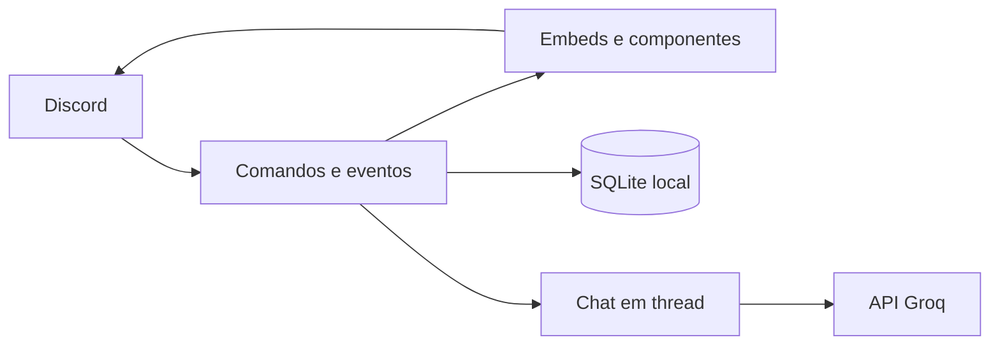

# Arquitetura e dados

O Marlon é um processo Python conectado ao gateway do Discord. `runtime.py` cria o bot; `groups.py` e os módulos em `commands/` registram os slash commands. `events.py` registra os eventos. A conexão só começa em `main()`, depois da inicialização do banco.

O chat e a economia são caminhos distintos. O modelo recebe uma instrução com a personalidade e uma lista de comandos, mas não executa ferramentas e não lê o SQLite. Não há memória de conversa implementada.

## Persistência

| Tabela | Conteúdo |
| --- | --- |
| `usuarios` | ID Discord, saldo, bio, destaques e horários das recompensas. |
| `emblemas` | Nome, emoji, URL da imagem, descrição, data, preço e disponibilidade na loja. |
| `inventario` | Relação usuário–emblema e data do resgate. |
| `codigos` | Código, emblema, limite de uso, usos, validade e estado ativo. |

A reorganização conserva o esquema e as migrações existentes. As conexões usam `DATABASE_PATH`; o arquivo não é aberto durante um simples import do pacote. Os dados não são separados por `guild_id`, portanto a mesma instância não deve servir comunidades que precisam de economias independentes.

SQLite mantém a instalação simples para um bot pequeno em uma única máquina. As consultas ainda são síncronas. A revisão não introduz filas, cache distribuído ou múltiplas instâncias, porque o código não tem essa arquitetura.

## Componentes de interface

- Perfis e catálogo usam views com botões de paginação.
- O ranking alterna entre moedas e quantidade de emblemas por um select.
- A loja monta botões de compra, limitados aos primeiros 25 itens.
- O modal de JSON transforma conteúdo e embeds em mensagens no canal escolhido.
- Os anúncios de cinema usam timestamps do Discord a partir da data informada.

As datas são interpretadas no horário local do processo, como no código original. Configure o fuso do ambiente ao executar. Views criadas em memória não são restauradas automaticamente depois de reiniciar o bot.

## Caminhos para evoluir

Antes de ampliar o uso: revisar a branch de proteção, testar a interface em um servidor isolado e definir o ciclo de backup do SQLite. Depois, vale separar regras econômicas da camada Discord, adicionar transações explícitas para concorrência entre processos e tratar migrações de esquema de forma versionada. Suporte a vários servidores exigiria rever as chaves de todas as tabelas.
